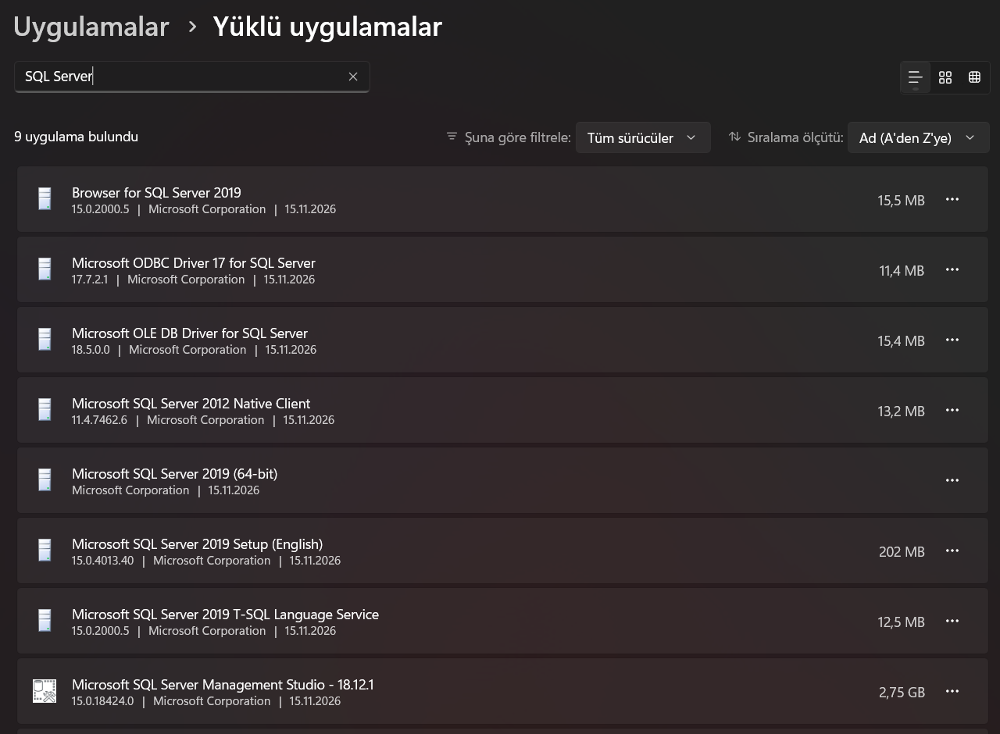
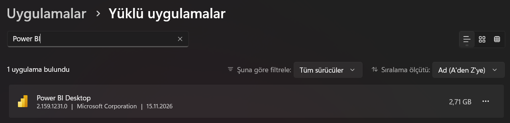
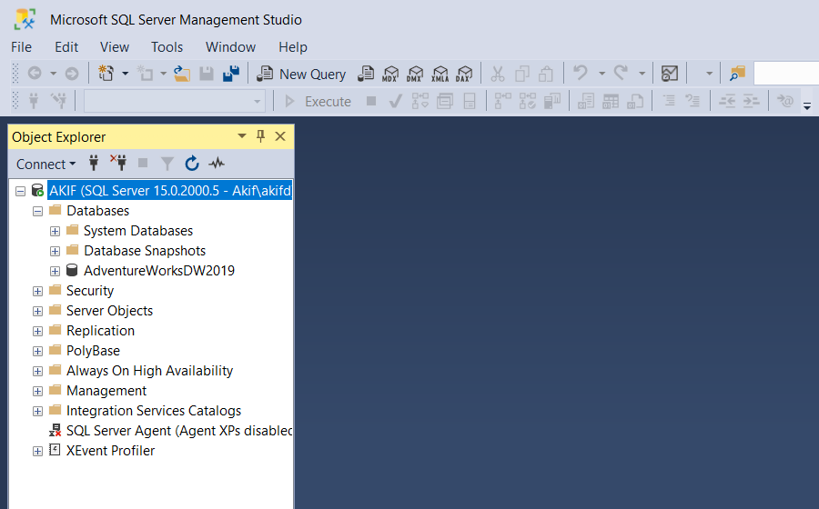
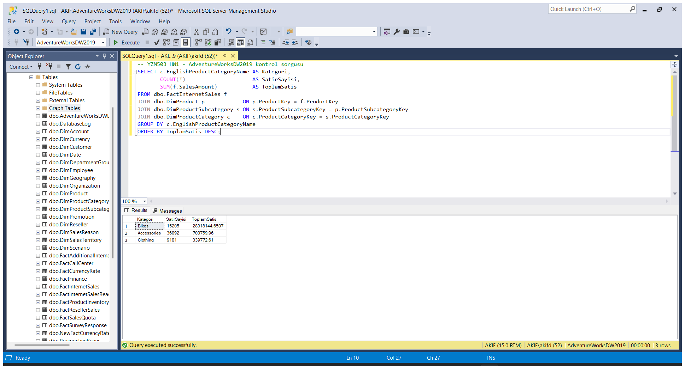
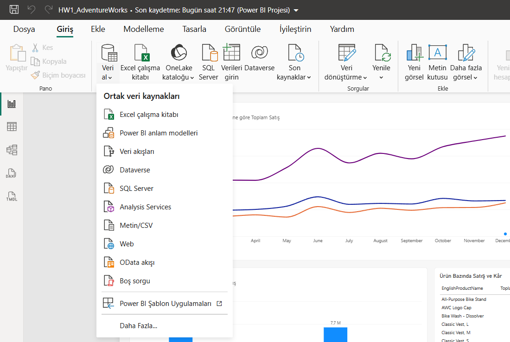
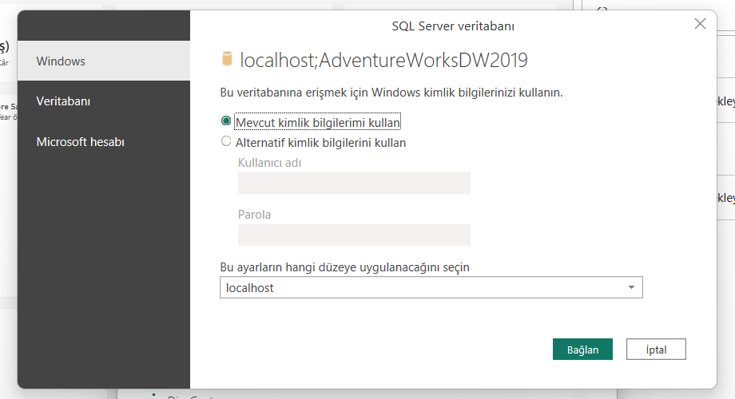
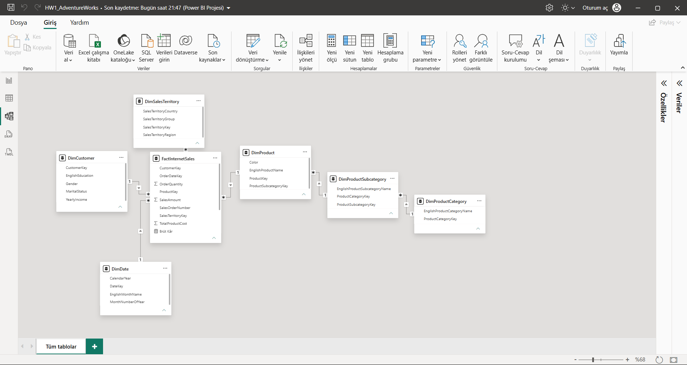
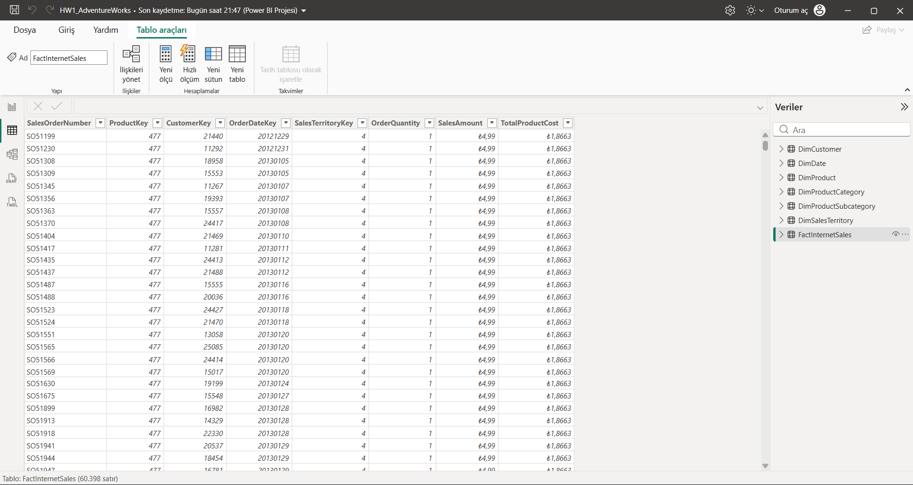
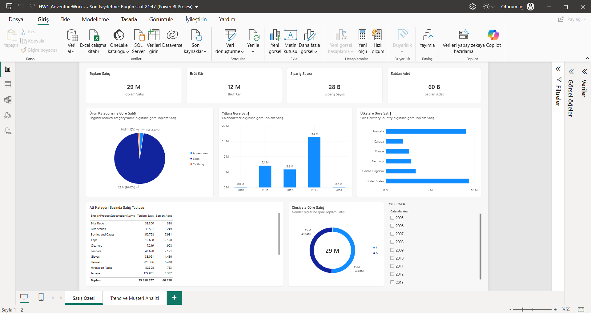
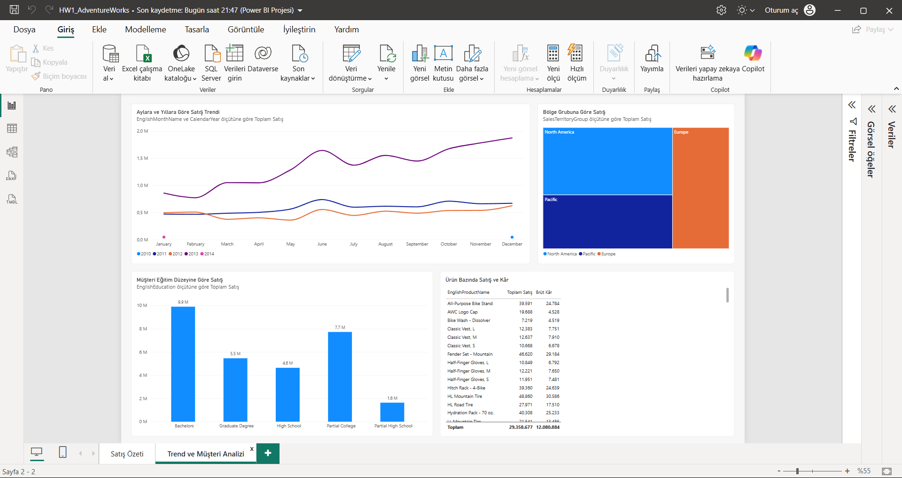

# YZM503 İş Zekâsı – Ödev 1: SQL Server, AdventureWorks ve Power BI

**Hazırlayan:** Akif Dalak – 269797001

Bu ödevde MS SQL Server üzerinde AdventureWorks veri ambarı kurulmuş ve Power BI Desktop ile bu veri ambarından etkileşimli raporlar üretilmiştir.

## Ödev tanımı

1. MS SQL Server kurulumu
2. Adventure Works veritabanının eklenmesi
3. Power BI aracı ile rapor üretilmesi

Her adımın ekran görüntüsü alınarak kişiye özel bir rapor hazırlanması istenmiştir.

> **Not:** Ödevde SQL Server 2008 istenmektedir. Ancak SQL Server 2008 Windows 11 üzerine kurulamadığı için güncel **SQL Server 2019** sürümü ve **AdventureWorksDW2019** veritabanı kullanılmıştır.

## Repo içeriği

| Klasör / dosya | İçerik |
|---|---|
| [`rapor/`](rapor/) | Teslim edilen rapor (Word ve PDF, 11 sayfa) |
| [`powerbi/`](powerbi/) | Power BI projesi (`HW1_AdventureWorks.pbip`): veri modeli + 2 rapor sayfası |
| [`sql/`](sql/) | Veritabanı geri yükleme ve kontrol sorguları |
| [`ekran_goruntuleri/`](ekran_goruntuleri/) | Rapordaki tüm ekran görüntüleri |
| [`scripts/`](scripts/) | Power BI projesini ve Word raporunu üreten yardımcı betikler |

## Kullanılan ortam

| Bileşen | Sürüm |
|---|---|
| Windows 11 Pro | 64-bit |
| Microsoft SQL Server 2019 | 15.0.2000.5 (varsayılan örnek, Windows kimlik doğrulaması) |
| SQL Server Management Studio | 18.12.1 |
| Power BI Desktop | 2.159.1231.0 (Microsoft Store) |
| Veri seti | AdventureWorksDW2019 |

## Veri seti

AdventureWorks, Microsoft'un eğitim amaçlı yayınladığı ve hayali bir bisiklet şirketinin satış, müşteri ve ürün verilerini içeren örnek veritabanıdır. Raporlamaya uygun **veri ambarı (DW)** sürümü kullanılmıştır.

- Kaynak: [Microsoft/sql-server-samples – AdventureWorks releases](https://github.com/Microsoft/sql-server-samples/releases/tag/adventureworks)
- Dosya: `AdventureWorksDW2019.bak` (~100 MB, boyutu nedeniyle repoya eklenmemiştir)

## Adımlar

### 1. SQL Server kurulumu

SQL Server 2019 ve SSMS kurulmuştur.



### 2. Power BI Desktop kurulumu

Power BI Desktop, Microsoft Store üzerinden kurulmuştur.



### 3. AdventureWorksDW2019 veritabanının eklenmesi

Yedek dosyası [`sql/01_restore_adventureworks.sql`](sql/01_restore_adventureworks.sql) içindeki `RESTORE DATABASE` komutuyla sunucuya geri yüklenmiştir.



### 4. Verinin SSMS ile kontrolü

[`sql/02_kontrol_sorgusu.sql`](sql/02_kontrol_sorgusu.sql) ile kategori bazında satışlar sorgulanmıştır.



### 5. Power BI'dan SQL Server'a bağlanma

Power BI'da **Giriş > Veri al > SQL Server** seçeneği kullanılmıştır. Sunucu olarak `localhost`, veritabanı olarak `AdventureWorksDW2019` girilmiş, bağlantı modu "İçeri aktar" olarak bırakılmıştır.





### 6. Veri modeli (yıldız şema)

Modelde 1 olgu tablosu (`FactInternetSales`) ve 6 boyut tablosu kullanılmıştır: `DimProduct`, `DimProductSubcategory`, `DimProductCategory`, `DimCustomer`, `DimDate` ve `DimSalesTerritory`.





**DAX ölçüleri**

| Ölçü | DAX |
|---|---|
| Toplam Satış | `SUM(FactInternetSales[SalesAmount])` |
| Toplam Maliyet | `SUM(FactInternetSales[TotalProductCost])` |
| Brüt Kâr | `[Toplam Satış] - [Toplam Maliyet]` |
| Sipariş Sayısı | `DISTINCTCOUNT(FactInternetSales[SalesOrderNumber])` |
| Satılan Adet | `SUM(FactInternetSales[OrderQuantity])` |

### 7. Power BI raporları

**Sayfa 1 – Satış Özeti:** KPI kartları, kategoriye göre pasta grafik, yıllara ve ülkelere göre satış grafikleri, alt kategori tablosu, cinsiyete göre halka grafik ve yıl dilimleyicisi.



**Sayfa 2 – Trend ve Müşteri Analizi:** aylık satış trendi, bölge grubu ağaç haritası, eğitim düzeyine göre satış ve ürün bazında satış/kâr tablosu.



## Bulgular

- İnternet satışlarının toplamı **29.358.677**, brüt kâr **12.080.884**'tür (yaklaşık %41 brüt kâr marjı). 27.659 siparişte 60.398 adet ürün satılmıştır.
- Satışların **%96,5'i Bikes** kategorisinden gelmektedir. Alt kategorilerde Road Bikes (14,52 M) ilk sıradadır.
- En yüksek satış **2013** yılındadır (16,35 M).
- Ülke bazında **ABD (9,39 M)** ve **Avustralya (9,06 M)** öne çıkmaktadır.
- Kadın ve erkek müşterilerin satış payı neredeyse eşittir (%50,5 / %49,5).
- Power BI'daki toplamlar SSMS sorgu sonuçlarıyla birebir aynıdır.

## Projeyi çalıştırma

1. SQL Server 2019'u kurun ve `AdventureWorksDW2019.bak` dosyasını indirip `C:\AWBackup\` klasörüne koyun.
2. Veritabanını geri yükleyin:
   ```bash
   sqlcmd -S localhost -E -C -i sql/01_restore_adventureworks.sql
   ```
3. `powerbi/HW1_AdventureWorks.pbip` dosyasını Power BI Desktop ile açın ve **Şimdi yenile** düğmesine basarak verileri yükleyin. Veri önbelleği repoda bulunmadığı için ilk açılışta yenileme gerekir.
